# infokobuleti.com — Data model (Phase 3)

Status: **approved** and implemented in Phase 3 (`database/migrations/2026_10_25_1000*`).

## Conventions

- PostgreSQL 17. Primary keys `bigint` identity. All timestamps `timestamptz`, app timezone Asia/Tbilisi.
- Translatable user content (`title`, `description`, `name`, `address`, `content`, ...) is `jsonb`
  shaped `{"ka": "...", "en": "...", "ru": "..."}` (spatie/laravel-translatable). `ka` is required.
- Every enum column is `varchar` backed by a PHP backed enum in `app/Enums`; labels come from
  `lang/{ka,en,ru}/enums.php`. No database enum types (cheap to extend).
- Money is `numeric`, never float. Currency is `GEL | USD | EUR`.
- Coordinates are `numeric(10,7)` `lat` / `lng` (PostGIS is not installed; bounding-box queries use a
  btree index on `(lat, lng)`, distance uses the haversine formula).
- Polymorphic columns use a short enforced morph map: `user`, `business_profile`, `hotel`, `room_type`,
  `property`, `classified`, `vacancy`, `vacancy_application`, `place`, `article`, `event`, `review`,
  `message`, `promotion`, `payment`.
- Soft deletes on users, business profiles, all modules, reviews and messages. Uniques that must
  survive soft deletes (user phone/email/google_id, slugs) are partial: `WHERE deleted_at IS NULL`.
- Extensions enabled by migration: `vector` (pgvector 0.8.7, already installed) and `pg_trgm`.

## Changes from the Phase 3 spec

| Spec | Proposed | Reason |
| --- | --- | --- |
| `jobs` table / `Job` model | `vacancies` / `Vacancy`, `vacancy_applications` | `jobs` is Laravel's queue table (already migrated) and `App\Jobs` is the queued-jobs namespace. Public URLs and UI copy stay "jobs" / "ვაკანსიები". |
| `listings` (classifieds) | `classifieds` / `Classified` | "listing" is the generic word for any module item across the codebase and lang files (`listing.*`). |
| Status list | adds `paused` | Phase 7 needs "pause listing" without losing its expiry. |
| (not in spec) | `price_gel` on properties and classifieds | Filtering and sorting by price across GEL/USD/EUR listings needs one normalized column; recalculated daily from NBG rates. |
| (not in spec) | promotion cache columns on promotable modules: `promotion_level`, `promoted_until`, `bumped_at` | Phase 8 ordering (Super VIP > VIP > last bump > published date) as one indexed `ORDER BY`, without joining `promotions`. |
| (not in spec) | moderation columns: `rejection_reason`, `moderated_by`, `moderated_at`, `risk_score` | Phase 5 moderation queue and the Phase 9 risk column. |
| (not in spec) | `benefits` jsonb on vacancies (accommodation, meals, transport) | Typical for seasonal Kobuleti jobs; filterable. |
| (not in spec) | `bathrooms` on properties; Georgian `condition` values (white/black/green frame) | Standard fields on Georgian real estate sites. |

Deferred on purpose (added in the phase that uses them): wallet and price-list/package tables
(Phase 8), staff 2FA columns and OTP codes (Phase 4), database notifications and user blocks (Phase 7),
feature flags, AI cost log and perceptual hashes (Phase 9), redirects and SEO templates (Phase 10).

## ERD — core and modules

```mermaid
erDiagram
    USERS ||--o{ BUSINESS_PROFILES : owns
    USERS ||--o{ HOTELS : owns
    USERS ||--o{ PROPERTIES : owns
    USERS ||--o{ CLASSIFIEDS : owns
    USERS ||--o{ VACANCIES : owns
    USERS ||--o{ ARTICLES : writes
    BUSINESS_PROFILES ||--o{ HOTELS : "operates (optional)"
    BUSINESS_PROFILES ||--o{ PROPERTIES : "agency (optional)"
    BUSINESS_PROFILES ||--o{ VACANCIES : "employer (optional)"
    BUSINESS_PROFILES ||--o{ PLACES : "claims (optional)"

    LOCATIONS ||--o{ LOCATIONS : parent
    LOCATIONS ||--o{ HOTELS : in
    LOCATIONS ||--o{ PROPERTIES : in
    LOCATIONS ||--o{ CLASSIFIEDS : in
    LOCATIONS ||--o{ VACANCIES : in
    LOCATIONS ||--o{ PLACES : in
    LOCATIONS ||--o{ EVENTS : in
    LOCATIONS ||--o{ BUSINESS_PROFILES : in

    CATEGORIES ||--o{ CATEGORIES : parent
    CATEGORIES ||--o{ CLASSIFIEDS : classifies
    CATEGORIES ||--o{ VACANCIES : classifies
    CATEGORIES ||--o{ ARTICLES : classifies
    CATEGORIES ||--o{ EVENTS : classifies

    HOTELS ||--o{ ROOM_TYPES : has
    ROOM_TYPES ||--o{ ROOM_TYPE_PRICE_RULES : "seasonal prices"
    ROOM_TYPES ||--o{ ROOM_AVAILABILITY : "date exceptions"
    HOTELS ||--o{ BOOKING_REQUESTS : receives
    ROOM_TYPES ||--o{ BOOKING_REQUESTS : "for (optional)"
    USERS ||--o{ BOOKING_REQUESTS : "sends (optional)"

    VACANCIES ||--o{ VACANCY_APPLICATIONS : receives
    USERS ||--o{ VACANCY_APPLICATIONS : sends

    PLACES ||--o{ EVENTS : "venue (optional)"

    AMENITIES ||--o{ AMENITYABLES : ""
    HOTELS ||--o{ AMENITYABLES : amenities
    ROOM_TYPES ||--o{ AMENITYABLES : amenities
    PROPERTIES ||--o{ AMENITYABLES : features

    USERS {
        bigint id PK
        varchar name
        varchar email UK "nullable"
        varchar phone UK "E.164, nullable"
        timestamptz phone_verified_at
        timestamptz email_verified_at
        varchar google_id UK "nullable"
        varchar password "nullable, staff only"
        varchar avatar "Google avatar URL"
        varchar locale "ka|en|ru"
        varchar account_type "individual|business"
        boolean is_blocked
        text blocked_reason
        timestamptz last_seen_at
        timestamptz deleted_at
    }
    BUSINESS_PROFILES {
        bigint id PK
        bigint user_id FK
        varchar type "hotel|agency|employer|service|restaurant"
        varchar name
        varchar slug UK
        jsonb description "translatable"
        varchar phone
        varchar email
        varchar website
        jsonb socials
        jsonb address "translatable"
        bigint location_id FK
        decimal lat
        decimal lng
        timestamptz verified_at
        decimal rating_avg
        int reviews_count
    }
    LOCATIONS {
        bigint id PK
        bigint parent_id FK
        varchar type "municipality|town|borough|village|district|protected_area"
        jsonb name "translatable"
        varchar slug UK
        decimal lat
        decimal lng
        smallint sort
        boolean is_active
    }
    CATEGORIES {
        bigint id PK
        bigint parent_id FK
        varchar module "classifieds|vacancies|news|events"
        jsonb name "translatable"
        varchar slug "unique per module"
        varchar icon
        smallint sort
        jsonb attribute_schema "category-specific fields"
        boolean is_active
    }
    HOTELS {
        bigint id PK
        varchar type "hotel|guesthouse|apartment|cottage|hostel"
        smallint stars "1-5, nullable"
        int distance_to_sea_m
        time check_in_from
        time check_out_until
        decimal price_from "GEL, cached min room price"
        smallint rooms_count
        smallint season_start_month "null = all year"
        smallint season_end_month
        varchar contact_phone
        varchar contact_email
        varchar website
        decimal rating_avg
        int reviews_count
    }
    ROOM_TYPES {
        bigint id PK
        bigint hotel_id FK
        jsonb name "translatable"
        jsonb description "translatable"
        smallint capacity_adults
        smallint capacity_children
        jsonb beds "type + count"
        smallint size_m2
        decimal base_price "GEL per night"
        smallint units "rooms of this type"
        smallint sort
    }
    ROOM_TYPE_PRICE_RULES {
        bigint id PK
        bigint room_type_id FK
        jsonb name "translatable, e.g. high season"
        date starts_on
        date ends_on
        decimal price "GEL per night"
        smallint min_nights
    }
    ROOM_AVAILABILITY {
        bigint id PK
        bigint room_type_id FK
        date date "exceptions only; unique with room_type_id"
        boolean is_closed
        decimal price_override
        smallint units_available
    }
    BOOKING_REQUESTS {
        bigint id PK
        bigint hotel_id FK
        bigint room_type_id FK
        bigint user_id FK "nullable"
        date check_in
        date check_out
        smallint adults
        smallint children
        varchar contact_name
        varchar contact_phone
        varchar contact_email
        text message
        varchar status "pending|accepted|declined|cancelled|expired"
        text owner_note
        timestamptz responded_at
        varchar locale
    }
    PROPERTIES {
        bigint id PK
        varchar deal "sale|rent|daily_rent"
        varchar type "apartment|house|land|commercial|hotel_business"
        decimal price
        varchar currency "GEL|USD|EUR"
        decimal price_gel "normalized, NBG rate"
        decimal price_per_m2 "generated: price / area_m2"
        decimal area_m2
        decimal land_area_m2
        smallint rooms
        smallint bedrooms
        smallint bathrooms
        smallint floor
        smallint total_floors
        varchar condition "newly_renovated|old_renovation|needs_renovation|white_frame|black_frame|green_frame"
        varchar building_status "new|old|under_construction"
        varchar cadastral_code
        varchar listed_by "owner|agency"
        int distance_to_sea_m
        varchar contact_name
        varchar contact_phone
    }
    CLASSIFIEDS {
        bigint id PK
        bigint category_id FK
        decimal price "null = by agreement"
        varchar currency
        decimal price_gel
        boolean negotiable
        varchar condition "new|used"
        jsonb attribute_values "validated against category schema"
        varchar contact_name
        varchar contact_phone
    }
    VACANCIES {
        bigint id PK
        bigint category_id FK
        varchar employment_type "full_time|part_time|seasonal|remote"
        int salary_min
        int salary_max
        varchar salary_currency
        varchar salary_period "hour|day|month|season"
        varchar experience "none|under_1|1_3|3_5|over_5"
        jsonb languages "ka, en, ru, tr..."
        jsonb benefits "accommodation, meals, transport"
        date deadline
        varchar apply_method "site|phone|email"
        varchar apply_phone
        varchar apply_email
    }
    VACANCY_APPLICATIONS {
        bigint id PK
        bigint vacancy_id FK
        bigint user_id FK
        text cover_note
        varchar contact_phone
        varchar status "new|viewed|shortlisted|rejected|hired"
        timestamptz status_changed_at
    }
    PLACES {
        bigint id PK
        varchar type "beach|sight|nature|restaurant|cafe|museum|service"
        jsonb content "translatable rich text"
        jsonb opening_hours "per weekday"
        varchar phone
        varchar email
        varchar website
        smallint price_level "1-4, nullable"
        decimal rating_avg
        int reviews_count
    }
    ARTICLES {
        bigint id PK
        bigint user_id FK "author"
        bigint category_id FK
        varchar slug UK
        jsonb title
        jsonb excerpt
        jsonb body "translatable rich text"
        varchar status
        timestamptz published_at
        boolean is_featured
        int views_count
    }
    EVENTS {
        bigint id PK
        bigint category_id FK
        bigint place_id FK "nullable"
        timestamptz starts_at
        timestamptz ends_at
        boolean is_all_day
        jsonb venue "translatable"
        varchar organizer
        varchar ticket_url
        boolean is_free
        decimal price_from
    }
    AMENITIES {
        bigint id PK
        varchar scope "hotel|room|property"
        varchar group
        jsonb name "translatable"
        varchar slug "unique per scope"
        varchar icon
        smallint sort
        boolean is_filterable
    }
    AMENITYABLES {
        bigint amenity_id FK
        varchar amenityable_type
        bigint amenityable_id
    }
```

### Columns shared by every module (not repeated in the diagram)

Applied to `hotels`, `properties`, `classifieds`, `vacancies`, `places`, `events`
(`articles` keeps only the status/slug/translation/views/soft-delete subset shown above).

| Column | Type | Notes |
| --- | --- | --- |
| `user_id` | FK users | owner; staff user for guide content |
| `business_profile_id` | FK business_profiles, nullable | |
| `status` | varchar | `draft, pending, published, rejected, paused, expired, archived` |
| `published_at`, `expires_at` | timestamptz, nullable | `expires_at` null for places and events |
| `slug` | varchar | unique per table among non-deleted rows |
| `title`, `description` | jsonb | translatable |
| `location_id` | FK locations, nullable | |
| `lat`, `lng` | numeric(10,7), nullable | |
| `address` | jsonb, nullable | translatable |
| `views_count` | int, default 0 | |
| `rejection_reason`, `moderated_by`, `moderated_at` | text, FK users, timestamptz | |
| `risk_score` | smallint, nullable | filled in Phase 9 |
| `promotion_level`, `promoted_until`, `bumped_at` | smallint, timestamptz, timestamptz | hotels, properties, classifieds, vacancies only |
| `embedding` | vector(1024), nullable | hotels, properties, classifieds, vacancies, places; filled in Phase 9 |
| `created_at`, `updated_at`, `deleted_at` | timestamptz | |

### Status transitions (`HasStatus`)

| From | Allowed to |
| --- | --- |
| draft | pending; published (staff only, enforced by policy) |
| pending | published, rejected, draft (owner withdraws) |
| rejected | pending (after edit) |
| published | paused, expired, archived, pending (re-moderation after a significant edit) |
| paused | published (only if not past `expires_at`), archived |
| expired | pending (renew), archived |
| archived | draft (staff restore) |

Entering `published` sets `published_at` (first time) and `expires_at` (now + module expiry days,
from settings in Phase 5; config default until then). Invalid transitions throw
`InvalidStatusTransition`. Every transition is written to the activity log.

## ERD — shared and polymorphic

`LISTING` stands for any morph-mapped model (hotel, property, classified, vacancy, place, event,
article, business_profile, ...); which models accept each relation is listed in the table below.

```mermaid
erDiagram
    USERS ||--o{ FAVORITES : saves
    LISTING ||--o{ FAVORITES : favoritable
    USERS ||--o{ REVIEWS : writes
    LISTING ||--o{ REVIEWS : reviewable
    USERS ||--o{ REPORTS : files
    LISTING ||--o{ REPORTS : reportable
    LISTING ||--o{ DAILY_STATS : statable
    USERS ||--o{ SAVED_SEARCHES : has
    LISTING ||--o{ CONVERSATIONS : "subject (optional)"
    CONVERSATIONS ||--o{ CONVERSATION_PARTICIPANTS : has
    USERS ||--o{ CONVERSATION_PARTICIPANTS : joins
    CONVERSATIONS ||--o{ MESSAGES : contains
    USERS ||--o{ MESSAGES : sends
    LISTING ||--o{ PROMOTIONS : promotable
    USERS ||--o{ PROMOTIONS : buys
    PAYMENTS ||--o| PROMOTIONS : "pays for"
    USERS ||--o{ PAYMENTS : makes
    LISTING ||--o{ MEDIA : "spatie medialibrary"

    FAVORITES {
        bigint id PK
        bigint user_id FK
        varchar favoritable_type
        bigint favoritable_id
        timestamptz created_at
    }
    REVIEWS {
        bigint id PK
        bigint user_id FK
        varchar reviewable_type "hotel|place|business_profile"
        bigint reviewable_id
        smallint rating "1-10, check constraint"
        text body
        varchar status "pending|published|rejected"
        text owner_reply
        timestamptz replied_at
        varchar locale
        bigint moderated_by FK
    }
    REPORTS {
        bigint id PK
        bigint user_id FK "nullable"
        varchar reportable_type
        bigint reportable_id
        varchar reason "spam|fraud|duplicate|wrong_category|offensive|already_sold|other"
        text comment
        varchar status "open|resolved|dismissed"
        bigint handled_by FK
        timestamptz handled_at
        text resolution_note
    }
    DAILY_STATS {
        bigint id PK
        varchar statable_type
        bigint statable_id
        date date "unique with statable"
        int views
        int phone_reveals
        int favorites
        int messages
    }
    SAVED_SEARCHES {
        bigint id PK
        bigint user_id FK
        varchar module "hotels|properties|classifieds|vacancies"
        varchar name
        jsonb filters
        jsonb channels "email|push|telegram"
        varchar frequency "instant|daily|weekly"
        boolean is_active
        timestamptz last_notified_at
    }
    CONVERSATIONS {
        bigint id PK
        varchar subject_type "nullable"
        bigint subject_id
        timestamptz last_message_at
    }
    CONVERSATION_PARTICIPANTS {
        bigint conversation_id PK
        bigint user_id PK
        timestamptz last_read_at
        timestamptz archived_at
    }
    MESSAGES {
        bigint id PK
        bigint conversation_id FK
        bigint user_id FK
        text body
        timestamptz deleted_at
    }
    PROMOTIONS {
        bigint id PK
        varchar promotable_type
        bigint promotable_id
        bigint user_id FK
        bigint payment_id FK "nullable"
        varchar type "vip|super_vip|bump|featured_home"
        timestamptz starts_at
        timestamptz ends_at "null for bump"
        timestamptz cancelled_at
    }
    PAYMENTS {
        bigint id PK
        bigint user_id FK
        varchar payable_type "nullable"
        bigint payable_id
        varchar gateway "fake|bog|tbc"
        varchar gateway_order_id UK
        varchar idempotency_key UK
        decimal amount
        varchar currency
        varchar status "pending|paid|failed|cancelled|refunded|partially_refunded"
        decimal refunded_amount
        jsonb payload "raw gateway data"
        timestamptz paid_at
        timestamptz refunded_at
    }
```

| Relation | Accepted models |
| --- | --- |
| favorites | hotel, property, classified, vacancy, place, event |
| reviews | hotel, place, business_profile |
| reports | hotel, property, classified, vacancy, place, review, message, user |
| daily_stats | hotel, property, classified, vacancy, place, business_profile |
| conversation subject | hotel, property, classified, vacancy, booking request context via hotel |
| promotions | hotel, property, classified, vacancy |
| media | all modules, room_type, business_profile (logo), user (avatar), message (attachments), vacancy_application (CV, private disk) |

## Package tables (published migrations, unchanged)

- spatie/laravel-permission: `roles`, `permissions`, `model_has_roles`, `model_has_permissions`,
  `role_has_permissions`. Seeded roles: `super_admin`, `admin`, `moderator`, `business`, `user`.
- spatie/laravel-medialibrary: `media`. Conversions (queued): `thumb` 400w, `card` 800w, `large` 1600w,
  all WebP; `placeholder` 32w blurred, inlined as base64.
- spatie/laravel-activitylog: `activity_log`.
- Existing Laravel tables stay: `cache`, `cache_locks`, `jobs`, `job_batches`, `failed_jobs`,
  `sessions`, `password_reset_tokens`.

## Indexes

- Every foreign key and every morph pair `(type, id)`.
- Modules: `(status, published_at DESC)`; listing order
  `(status, promotion_level DESC, bumped_at DESC, published_at DESC)`; `expires_at`; `(lat, lng)`;
  `slug` partial unique.
- Filter columns: hotels `type, stars, distance_to_sea_m, price_from, rating_avg`; properties
  `(deal, type), price_gel, area_m2, rooms, floor, building_status, listed_by, distance_to_sea_m`;
  classifieds `price_gel, condition`; vacancies `employment_type, salary_min, salary_max, deadline`;
  places `type`; events `starts_at`; booking_requests `(hotel_id, status), check_in`.
- GIN `jsonb_path_ops`: `classifieds.attribute_values`, `vacancies.languages`, `vacancies.benefits`,
  `saved_searches.filters`.
- Full-text GIN (`simple` config, since PostgreSQL has no Georgian dictionary) over `title` and
  `description` in all three languages, per module. Meilisearch remains the main public search.
- HNSW `vector_cosine_ops` on every `embedding` column.
- Partial uniques: `users.email`, `users.phone`, `users.google_id` where `deleted_at IS NULL`;
  `favorites (user_id, favoritable_type, favoritable_id)`; `reviews (user_id, reviewable_type, reviewable_id)`;
  `vacancy_applications (vacancy_id, user_id)`; `room_availability (room_type_id, date)`;
  `daily_stats (statable_type, statable_id, date)`.
- Check constraints: `reviews.rating BETWEEN 1 AND 10`, `hotels.stars BETWEEN 1 AND 5`,
  `booking_requests.check_out > check_in`, `room_type_price_rules.ends_on >= starts_on`,
  `vacancies.salary_max >= salary_min`, `users.email IS NOT NULL OR users.phone IS NOT NULL`.

## Seed data

`DatabaseSeeder` runs `ReferenceDataSeeder` everywhere and `DemoSeeder` everywhere except production.
Content lives in `database/seeders/data/*.php`.

- Reference data (idempotent, `updateOrCreate`): the five roles; Kobuleti municipality → Kobuleti
  town (centre, north, south districts), Chakvi and Ochkhamuri boroughs, 15 villages, Kobuleti and
  Kintrishi Protected Areas and Mtirala National Park, with approximate centre coordinates;
  classifieds categories with attribute schemas (cars: make, model, year, mileage, fuel, transmission,
  steering, customs cleared; motorcycles, bicycles, phones), vacancy, news and event categories;
  hotel, room and property amenities.
- Demo content (fixed Faker seed, so names, prices and texts repeat between runs; which listings get
  promotions, conversations and reports is picked at random each time): staff accounts
  `superadmin@`, `admin@`, `moderator@infokobuleti.com`; 15 businesses (agencies, restaurants,
  employers, services) plus one verified profile per business hotel; 42 individual users (some
  phone-only, Google, unverified, one blocked).
- 30 hotels (the homepage names included) with 1-5 room types, high-season and June price rules
  and a few availability exceptions; 60 properties; 80 classifieds (cars and phones with full
  attribute values); 40 vacancies; 25 guide places (real beaches, sights and nature areas,
  fictional restaurants and cafes); 12 news articles; 8 events. A few listings per module are
  pending, draft, paused, rejected or expired so moderation screens have content.
- Engagement: reviews with owner replies, favorites, 40 booking requests, 30 applications,
  10 conversations, saved searches, reports, 14 days of daily stats, and Super VIP / VIP / bump /
  featured promotions with fake-gateway payments.
- No photos are seeded; cards show placeholders until owners upload images.
- Staff passwords come from `DEMO_PASSWORD` in `.env` (never committed). Without it the seeder
  generates a one-off password and prints it once.
